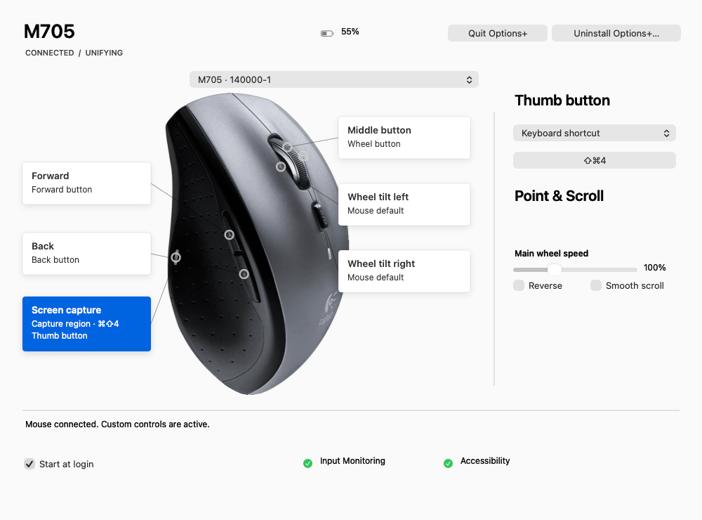
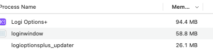

# MX Mouse

A lightweight native macOS alternative to Logitech Logi Options+ for compatible Logitech HID++ mice.

|        | MX Mouse helper (normal use) | Settings UI (only while open) | Logi Options+ |
|--------|-----------:|------------:|--------------:|
| Memory | **3.05–4.39 MiB** | **~29.1 MiB while open; 0 when closed** | 120+ MB |

**During normal use, only the small helper runs.** Open Settings to configure shortcuts and mouse options; its UI temporarily uses additional memory (~29.1 MiB measured in an earlier build). **Closing the Settings window exits the UI and releases its memory.** Your shortcuts and mouse settings keep working through the helper.

The helper range was measured with one M705 active; memory with two awake mice is still unverified. See [measurements and validation](docs/development.md#footprint).

## Supported mice

| Mouse | Connection | Notes |
| --- | --- | --- |
| MX Master 3 for Mac | Bluetooth | Previous builds verified on hardware; the shared feature path is retained. Apple Silicon, macOS 13+. |
| Logitech M705 variants | Logitech Unifying receiver | Controls come from the connected unit: a missing thumb button is never assumed. Discovery, configuration and battery reporting checked on `101b` with this implementation; newer `406d` needs physical testing. |
| MX Master 3S / 4 and other compatible HID++ 2.0+ mice | Direct Bluetooth / USB, or registered receivers | Features and controls are discovered dynamically. MX Master 4's Haptic panel can have a separate button binding; haptic feedback and gestures are not implemented. These new model/transport combinations still need hardware verification. |

[v0.2.0](https://github.com/ruibeard/logitech-options-plus-alternative/releases/tag/v0.2.0) manages multiple mice in one helper process, with separate settings and receiver-slot routing. Simultaneous operation is covered by automated tests and still needs physical testing with two awake mice. Bolt, Unifying and selected Nano/Lightspeed transports have discovery support; recognition does not guarantee every mouse feature is implemented. Unsupported controls stay native. [Protocol coverage and verification tiers](docs/development.md#capability-and-verification-tiers) distinguish implemented paths from hardware-tested support.

## Features

- [x] Custom buttons and shortcuts
- [x] Discover controls per mouse, including additional buttons
- [x] Multiple mice with separate settings in one helper process
- [x] Scroll, DPI, SmartShift
- [x] Import from Options+ (read-only)
- [x] Quit or uninstall Options+ from the app
- [x] Battery indicator when reported (percentage or coarse level)
- [x] Start at login
- [x] No account, no cloud

## Install

1. [Download](https://github.com/ruibeard/logitech-options-plus-alternative/releases), drag to Applications.
2. macOS gets nervous → **Open Anyway**.
3. Quit Logi Options+.
4. **Set Up…** → grant permissions.

## Uninstall

1. Turn off **Start at login**, then quit MX Mouse.
2. Stop the helper: `pkill -TERM -x mxmouse-helper`. The mouse goes back to normal.
3. Delete **MX Mouse Settings** from Applications.
4. Optional: delete `~/Library/Application Support/MX Mouse/` and remove **MX Mouse Helper** from Input Monitoring and Accessibility.

Where does 120+ MB come from?

Activity Monitor on the author's Mac: Logi Options+ 94.4 MB + updater 26.1 MB. `loginwindow` is part of macOS, so it does not count. Options+ can also run an agent process, so the real total can be higher.

[Build](docs/setup.md) · [Add a mouse](docs/development.md#architecture-and-adding-devices) · [Credits](docs/credits.md) · [MIT License](LICENSE) · Not affiliated with Logitech.
